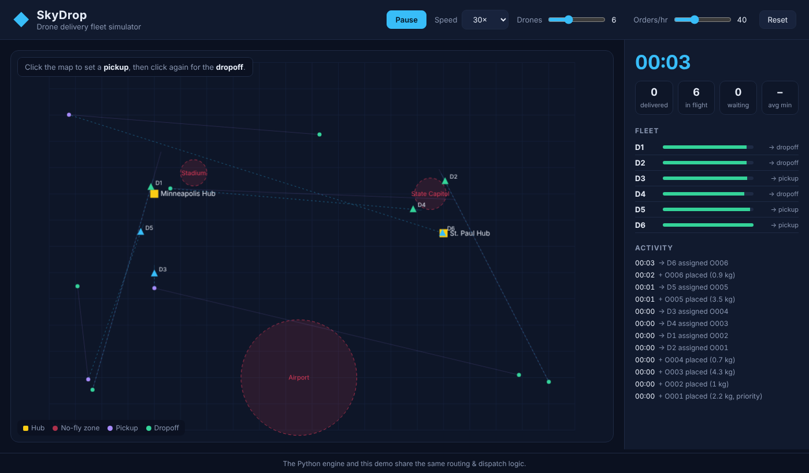

# 🚁 SkyDrop: Drone Delivery Simulator

A drone delivery fleet simulator. It routes drones around no-fly zones, models battery drain under payload, and dispatches orders to the best available drone. It ships with a **Python engine + CLI** and an **interactive browser demo** you can host free on GitHub Pages.



## Features

- **No-fly-zone routing.** A visibility-graph + Dijkstra planner finds the shortest safe path around circular restricted areas (airports, stadiums, government buildings), including overlapping zones.
- **Battery & payload model.** Energy use grows with distance and package weight. Drones only accept a job if they can finish it *and* fly back to a hub with a safety reserve left.
- **Smart dispatch.** Urgent orders go first. Each order is assigned to the drone with the earliest delivery ETA.
- **Multi-hub fleets.** After a delivery, drones return to the nearest hub and recharge there.
- **Mixed fleets.** Give drones different speeds, payload limits and battery sizes (e.g. a heavy-lift drone).
- **Rejects impossible orders up front**, with a reason (too heavy, out of range, inside a no-fly zone).
- **Reports & replays.** Delivery-time stats (avg / P90 / max), fleet distance and energy, per-drone breakdown, plus a JSON replay export.
- **Zero runtime dependencies.** Pure Python standard library.

## Quick start

```bash
git clone https://github.com/<your-username>/drone-delivery.git
cd drone-delivery
pip install -e ".[dev]"

# Run the bundled Twin Cities scenario
drone-delivery run --scenario examples/twin_cities.json

# Or generate a random city
drone-delivery run --drones 8 --orders 60 --zones 3 --seed 7

# Export a JSON replay of every drone's position over time
drone-delivery run --orders 30 --export replay.json
```

Example output:

```
Simulation report
========================================
Simulated time      : 40.5 min
Orders              : 10
  delivered         : 8
  failed            : 2
  still open        : 0
Avg delivery time   : 11.0 min
P90 delivery time   : 17.2 min
Max delivery time   : 17.2 min
Fleet distance      : 133.7 km
Fleet energy        : 1.99 kWh
```

No install needed to try it: `PYTHONPATH=src python -m drone_delivery run`

### CLI options

| Option | Default | Description |
| --- | --- | --- |
| `--scenario FILE` | – | Load a scenario JSON (otherwise a random city is generated) |
| `--seed N` | 42 | Random seed for generated cities |
| `--hubs / --drones / --orders / --zones` | 2 / 6 / 40 / 2 | Size of a generated city |
| `--size KM` | 12 | Width of a generated city |
| `--tick S` | 10 | Seconds per simulation step |
| `--reserve F` | 0.15 | Battery fraction that must remain after a job |
| `--export FILE` | – | Write a JSON replay |
| `--json` | off | Print the report as JSON |

## Interactive demo

The `docs/` folder is a self-contained web app: no build step, no dependencies. Run it locally:

```bash
cd docs && python -m http.server 8000
# open http://localhost:8000
```

**Put it on GitHub Pages:** in your repo go to *Settings → Pages → Build and deployment*, choose **Deploy from a branch**, branch `main`, folder `/docs`. Your demo will be live at `https://<your-username>.github.io/drone-delivery/`.

In the demo you can:
- click the map twice to place your own order (pickup, then dropoff)
- change fleet size, order rate and simulation speed
- watch each drone's route, battery level and status live

## Using it as a library

```python
from drone_delivery import Drone, Hub, NoFlyZone, Order, Point, Simulation

hub = Hub("H1", Point(0, 0))
sim = Simulation(
    hubs=[hub],
    drones=[Drone("D1", "H1", hub.location, max_payload_kg=5)],
    orders=[Order("O1", pickup=Point(1, 0), dropoff=Point(10, 0), weight_kg=2)],
    zones=[NoFlyZone(Point(5, 0), radius=1.5, name="Airport")],
)
print(sim.run().format())
```

## Scenario file format

See [`examples/twin_cities.json`](examples/twin_cities.json). Coordinates are kilometres on a flat grid.

```jsonc
{
  "hubs":  [{ "id": "MPLS", "name": "Minneapolis Hub", "location": { "x": 4, "y": 9 } }],
  "zones": [{ "name": "Airport", "center": { "x": 9.5, "y": 2 }, "radius": 2.2 }],
  "drone_defaults": { "speed_kmh": 65, "max_payload_kg": 5, "battery_capacity_wh": 550 },
  "drones": [
    { "hub": "MPLS", "count": 3 },
    { "hub": "MPLS", "id": "HEAVY-1", "max_payload_kg": 12, "speed_kmh": 45 }
  ],
  "orders": [
    { "id": "A1", "pickup": { "x": 4.5, "y": 8.5 }, "dropoff": { "x": 2, "y": 12 },
      "weight_kg": 1.2, "created_at": 0, "priority": 1 }
  ]
}
```

## How it works

```
order placed ──► feasibility check ──► pending queue
                                           │
          every tick: dispatcher ◄─────────┘
            • sort by priority, then age
            • for each idle/charging drone: plan hub→pickup→dropoff→nearest hub
            • keep plans that leave ≥ reserve battery
            • pick the lowest ETA
                     │
                     ▼
 IDLE/CHARGING ─► TO_PICKUP ─► TO_DROPOFF ─► RETURNING ─► CHARGING ─► IDLE
```

**Routing:** each no-fly zone is wrapped in a 12-sided polygon slightly larger than the zone. Polygon vertices plus the start and goal form a graph, with edges wherever a straight line doesn't cross a zone. Dijkstra returns the shortest safe path. Routes are cached.

**Energy:** `Wh = km × (base_wh_per_km + payload_kg × payload_wh_per_km_per_kg)`.

## Project layout

```
src/drone_delivery/
  geo.py          points, no-fly zones, geometry helpers
  planner.py      visibility-graph route planner
  models.py       Hub, Drone, Order + status enums
  dispatcher.py   feasibility checks and order assignment
  simulation.py   time-stepped simulation, reports, JSON export
  scenario.py     JSON loader and random city generator
  cli.py          command-line interface
tests/            pytest suite
examples/         sample scenarios
docs/             browser demo (GitHub Pages)
```

## Development

```bash
pip install -e ".[dev]"
pytest
```

CI runs the tests on Python 3.10–3.13 for every push and pull request (`.github/workflows/ci.yml`).

## Roadmap ideas

- Wind and weather effects on speed and energy
- Batching multiple packages per flight
- Real map coordinates (lat/lon) with OpenStreetMap tiles
- Collision avoidance and altitude layers
- Replay viewer for exported JSON in the web demo

## License

MIT. See [LICENSE](LICENSE).
